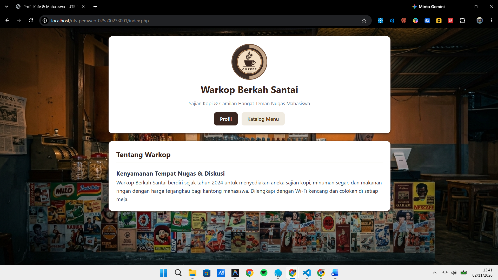
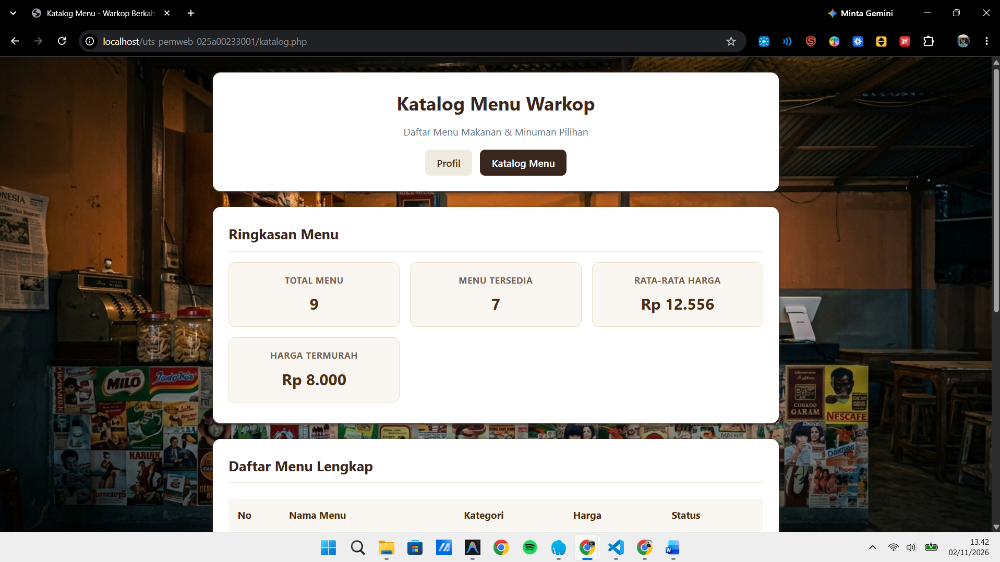

# Proyek Mini Individu: Website Profil & Katalog Dinamis (UTS Pemrograman Web)

Repositori ini dibuat untuk memenuhi tugas Ujian Tengah Semester (UTS) mata kuliah Pemrograman Web (253A23W15), Program Studi Informatika, Fakultas Teknik, Tiga Serangkai University.

---

## 1. Identitas Mahasiswa
* **Nama**  : Naufal Taufiqurrohman
* **NIM**   : 025a00233001
* **Kelas** : Informatika Semester 3
* **Dosen** : Pak Dziki

---

## 2. Deskripsi Singkat Tema
Tema yang dipilih adalah **Katalog Menu Kafe / Warkop (Warkop Berkah Santai)**. Website ini menyajikan profil usaha warkop beserta katalog menu makanan dan minuman secara dinamis menggunakan PHP native tanpa database. Data disimpan dalam array multidimensi dan diolah untuk menampilkan informasi status ketersediaan serta ringkasan statistik harga menu.

---

## 3. Cara Menjalankan di Localhost

###  Menggunakan PHP Built-in Server (Paling Cepat)
1. Buka terminal (Command Prompt / PowerShell) di dalam folder proyek ini.
2. Jalankan perintah server lokal PHP:
   ```bash
   php -S localhost:8000
   ```
3. Buka browser dan akses alamat berikut:
   * **Halaman Profil**: [http://localhost:8000/index.php](http://localhost:8000/index.php)
   * **Halaman Katalog**: [http://localhost:8000/katalog.php](http://localhost:8000/katalog.php)


---

## 4. Daftar Fitur dan Penanganannya

* **Sanitasi Output Anti-XSS** (`functions.php`) - Menggunakan fungsi `e(string $nilai): string` untuk membungkus `htmlspecialchars` agar output HTML aman dari script berbahaya.
* **Format Mata Uang Rupiah** (`functions.php`) - Menggunakan fungsi `formatRupiah(int $nominal): string` untuk mengubah angka integer harga menjadi format mata uang Rupiah (`Rp 15.000`).
* **Rata-rata Harga Menu** (`functions.php`) - Menggunakan fungsi `hitungRataRataHarga(array $daftar): float` untuk menghitung harga rata-rata seluruh menu menggunakan fungsi array bawaan.
* **Hitung Menu Tersedia** (`functions.php`) - Menggunakan fungsi `hitungTotalTersedia(array $daftar): int` untuk menghitung banyaknya item yang berstatus `tersedia => true`.
* **Render Tabel Menu Dinamis** (`katalog.php`) - Menggunakan perulangan `foreach` untuk menampilkan seluruh isi array `$daftarMenu` ke dalam baris tabel HTML secara otomatis.
* **Badge Status Ketersediaan** (`katalog.php`) - Menggunakan percabangan `if/else` untuk menampilkan badge hijau ("Tersedia") jika `tersedia === true`, atau badge merah ("Habis") jika `false`.
* **Navigasi Antarhalaman Semantik** (`index.php`, `katalog.php`) - Memanfaatkan tag `<header>`, `<nav>`, `<main>`, `<section>`, dan `<footer>` untuk menghubungkan halaman Profil dan Katalog Menu dengan transisi menu aktif.
* **Kalkulator & Total Pesanan** (`katalog.php`, `functions.php`) - Menggunakan logika `hitungTotalPesanan` untuk memilih jumlah pesanan menu, menghitung subtotal per item, menampilkan total biaya pembayaran, serta kalkulasi uang kembalian.
---

## 5. Daftar Fungsi Array Bawaan yang Dipakai

Dalam proyek ini digunakan 4 fungsi array bawaan PHP berbeda (melebihi batas minimal 3 fungsi):
1. **`count()`**:
   * *Lokasi*: `functions.php` & `katalog.php`.
   * *Kegunaan*: Menghitung jumlah total elemen dalam array data menu dan array hasil filter.
2. **`array_column()`**:
   * *Lokasi*: `functions.php` & `katalog.php`.
   * *Kegunaan*: Mengambil seluruh nilai dari satu kunci spesifik (`harga`) pada array multidimensi.
3. **`array_sum()`**:
   * *Lokasi*: `functions.php`.
   * *Kegunaan*: Menjumlahkan seluruh total harga menu yang diperoleh dari `array_column` untuk menghitung rata-rata.
4. **`array_filter()`**:
   * *Lokasi*: `functions.php` (fungsi `hitungTotalTersedia`).
   * *Kegunaan*: Menyaring menu berdasarkan kondisi nilai boolean `tersedia === true`.

---

## 6. Tangkapan Layar Halaman

Simpan hasil tangkapan layar di dalam folder `screenshots/`:

### 1. Tampilan Halaman Profil (`index.php`)


### 2. Tampilan Halaman Katalog Menu (`katalog.php`)


---

## 7. Sumber Referensi dan Catatan Pemakaian AI

### Referensi:
1. Dokumentasi Resmi PHP: [https://www.php.net/manual/en/](https://www.php.net/manual/en/) (untuk fungsi array dan strict typing).
2. Mozilla Developer Network (MDN): [https://developer.mozilla.org/en-US/docs/Web/HTML](https://developer.mozilla.org/en-US/docs/Web/HTML) (untuk elemen HTML5 semantik).
3. Standar Penulisan Kode PHP: [PSR-12 Extended Coding Style](https://www.php-fig.org/psr/psr-12/).

### Catatan Pemakaian AI:
* **Bagian yang dibantu**: AI digunakan untuk  perancangan struktur arsitektur file awal  , dan penyusunan draf templat dokumentasi README.
* **Metode pemeriksaan**: Semua kode program telah diperiksa dan diuji mandiri menggunakan PHP CLI (`php -l` untuk validasi sintaks dan eksekusi server lokal `php -S localhost:8000`) guna memastikan tidak ada notice, warning, maupun error. 